# DITHR

> **This is a fork of [redphx/dithr](https://github.com/redphx/dithr)** with added support for a
> USB NFC writer (PN532) in the web version, sending images from iPhone via a Mac, and touch
> improvements. See **[NFC-WRITER.md](./NFC-WRITER.md)** for setup and details.
>
> The changes in this fork were made with AI assistance. This fork is not affiliated with the
> original author – please don't report issues of this fork to the original project.


Free and open-source tool for dithering images, build especially for epaper & full-color screens.

## Features

- **Privacy first**  
  *No trackers. No ads. No uploads. No servers. All on-device.*
- **Mobile-optimized UI**  
  *The UI is designed with mobile users in mind.*
- **Multiple dithering methods**  
  *Supports error diffusion, ordered dithering, halftone patterns...*
- **Simple yet powerful canvas editor**  
  *Supports layers, images, texts, shapes...*
- **Direct hardware sync**  
  *Sync dithered image directly to supported devices, including Waveshare, Good Display, and EZ Sign displays.*

# Screenshots

### Web
<a href="./docs/screenshots/web-1.png">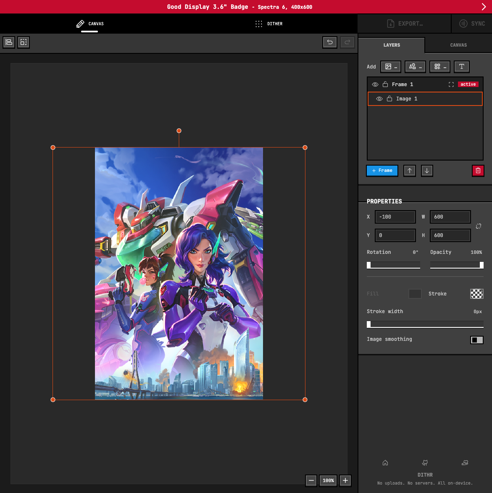</a>
<a href="./docs/screenshots/web-2.png">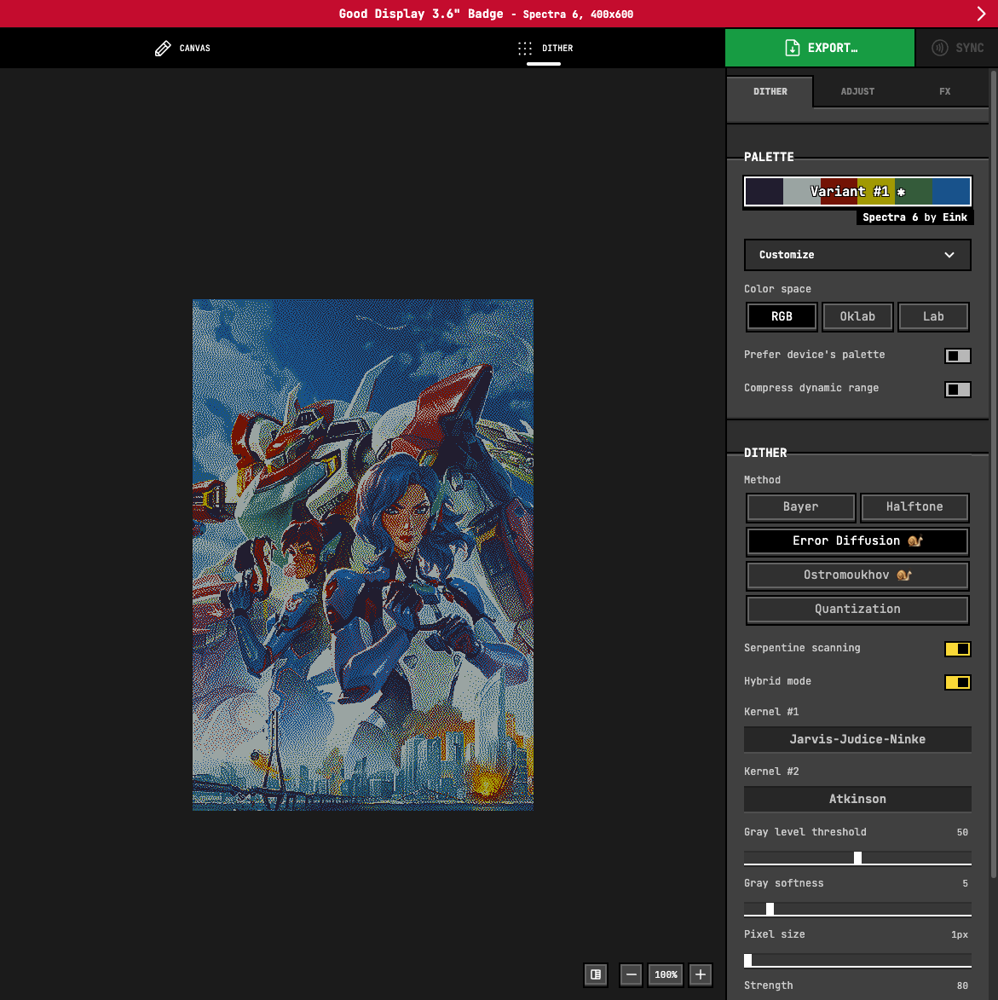</a>
<a href="./docs/screenshots/web-3.png">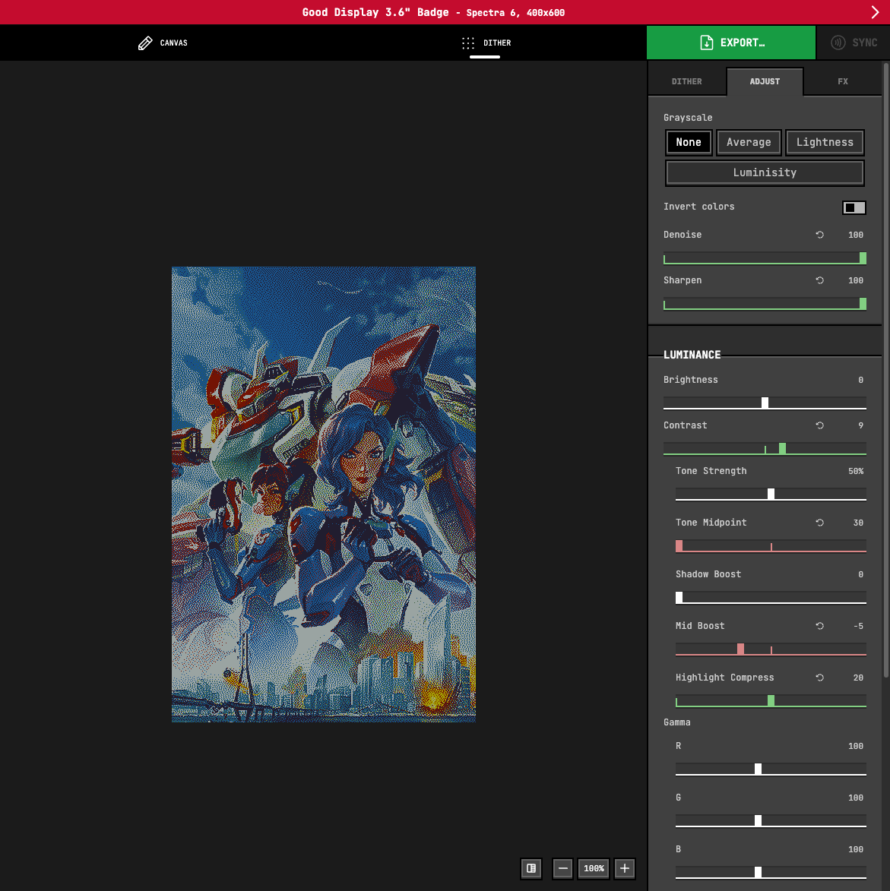</a>
<a href="./docs/screenshots/web-4.png">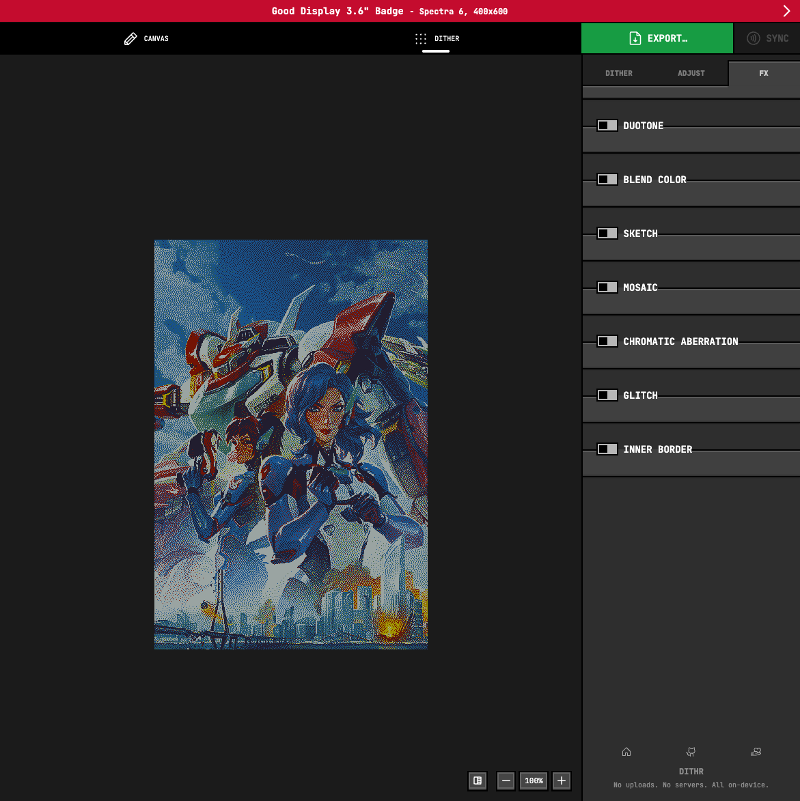</a>

### Android app
<a href="./docs/screenshots/android-1.png">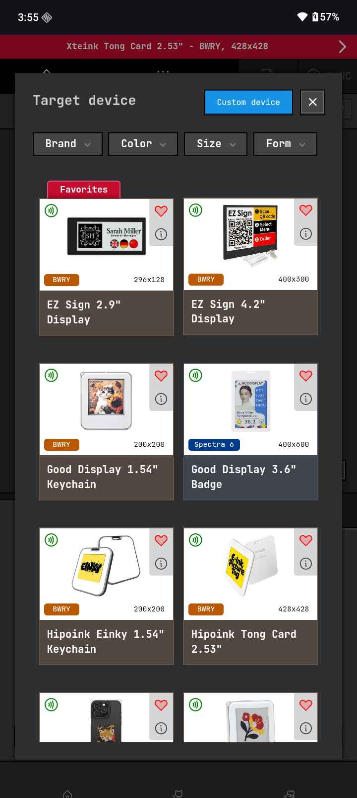</a>
<a href="./docs/screenshots/android-2.png">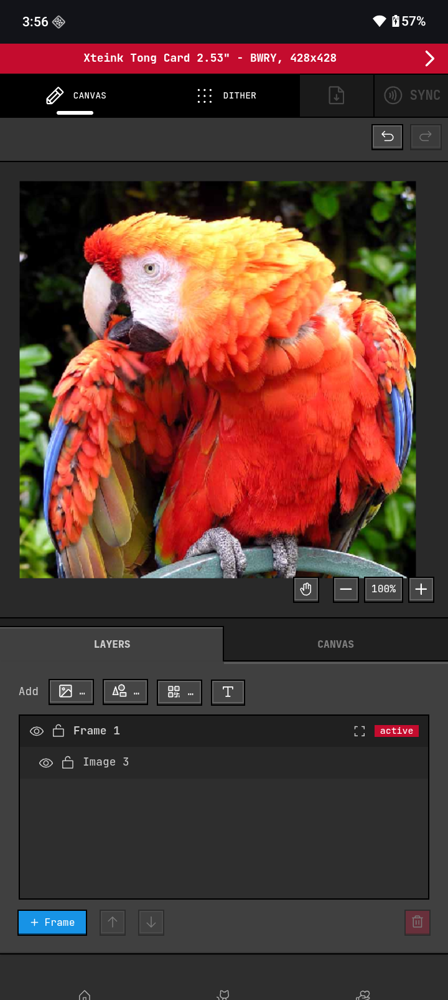</a>
<a href="./docs/screenshots/android-3.png">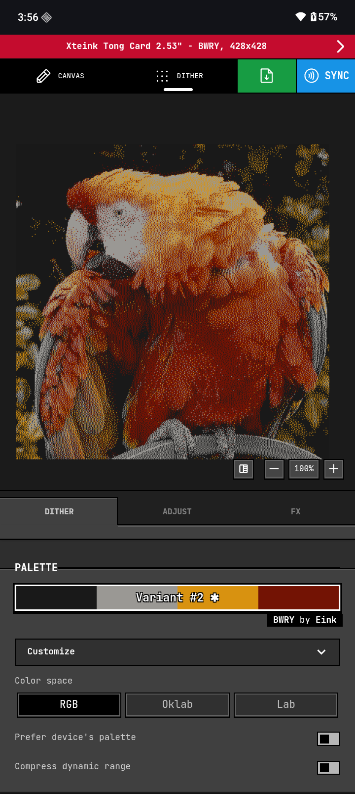</a>
<a href="./docs/screenshots/android-4.png">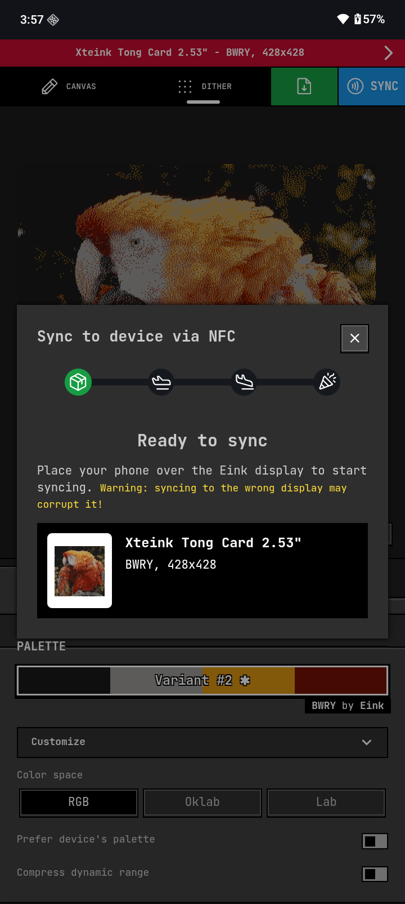</a>
<a href="./docs/screenshots/android-5.png">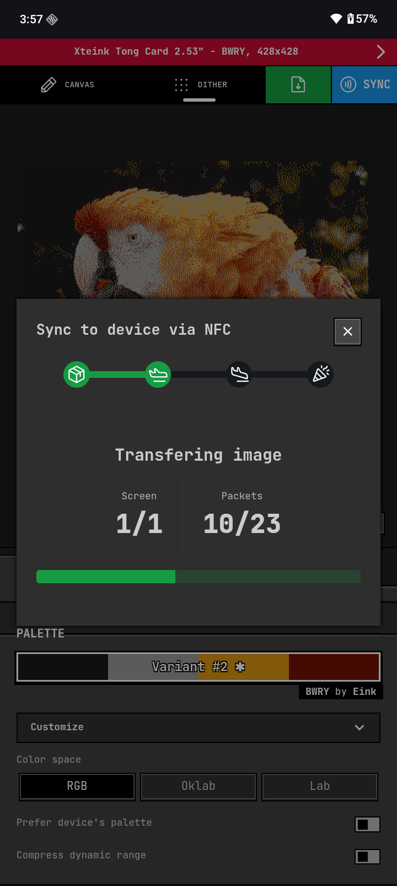</a>
<a href="./docs/screenshots/android-6.png">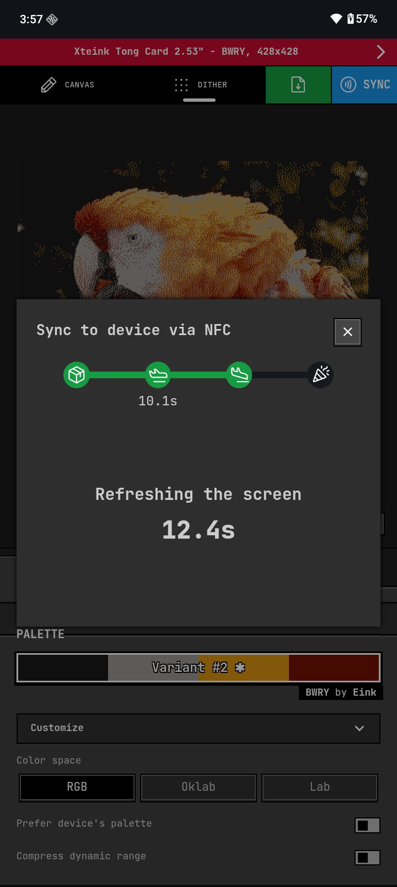</a>
<a href="./docs/screenshots/android-7.png">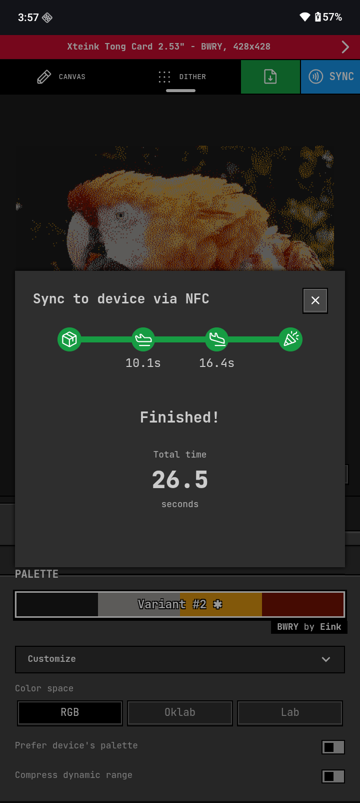</a>

## Supported NFC-powered screens

You can see the full list of supported screens inside the app.  
If your screen uses one of these apps for syncing, you can use DITHR app to sync image directly to them:

| Screen brand | Android app | iOS app |
|--|--|--|
| EZ Sign | 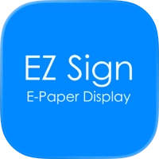 [EZ Sign(TM) NFC](https://play.google.com/store/apps/details?id=com.tpcl.picture.handle.picture_handle)<br>com.tpcl.picture.handle.picture_handle |  [EZ Sign(TM) NFC](https://apps.apple.com/app/ez-sign-tm-nfc/id6751824926)<br><br> |
| Waveshare | 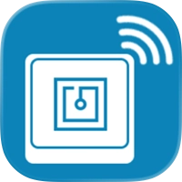 [NFCTag](https://www.waveshare.com/wiki/1.54inch_NFC-Powered_e-Paper_(G)#Android_APP)<br>waveshare.feng.nfctag |  [NFC E-Tag](https://apps.apple.com/us/app/nfc-e-tag/id1518982217)<br><br> |
| Xteink |  [Xteink](https://play.google.com/store/apps/details?id=com.xteink.xtplushpaper)<br>com.xteink.xtplushpaper |  [Xteink](https://apps.apple.com/app/xteink/id6754496214)<br><br> |
| Good Display & others | 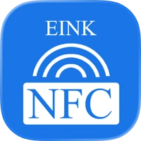 [NFC ESL](https://www.pgyer.com/SbeXPO1h)<br>com.fmsh.einkesl |  [NFC Eink](https://apps.apple.com/app/nfc-eink/id1539628050)<br><br> |

### Unsupported NFC-powered screens
- Vidabay (I don't have it)

### Tested on

- EZ Sign 2.13" Display (BWRY)
- EZ Sign 4.2" Display (BWRY)
- Good Display 3.6" Badge (Spectra 6)
- Hipoink Einky 1.54" Keychain (BWRY)
- Hipoink Tong Card 2.53" (BWRY)
- Reink iPhone case C1 3.7" (BWRY)
- Waveshare 1.54" Keychain (BWRY)

## AI usage disclosure
This is not a vibe-coded project. I used Claude (free tier) to assist me with creating shaders and the history + layers manager. Other than that I code it myself.

## Contribution

I accept contributions, unless the PR is AI-generated.

## Development

Test web app  
```sh
pnpm run dev --open
```  

Test android app  
```
pnpm run dev-app:android
```

## Acknowledments
> To be updated...

## License

MIT
